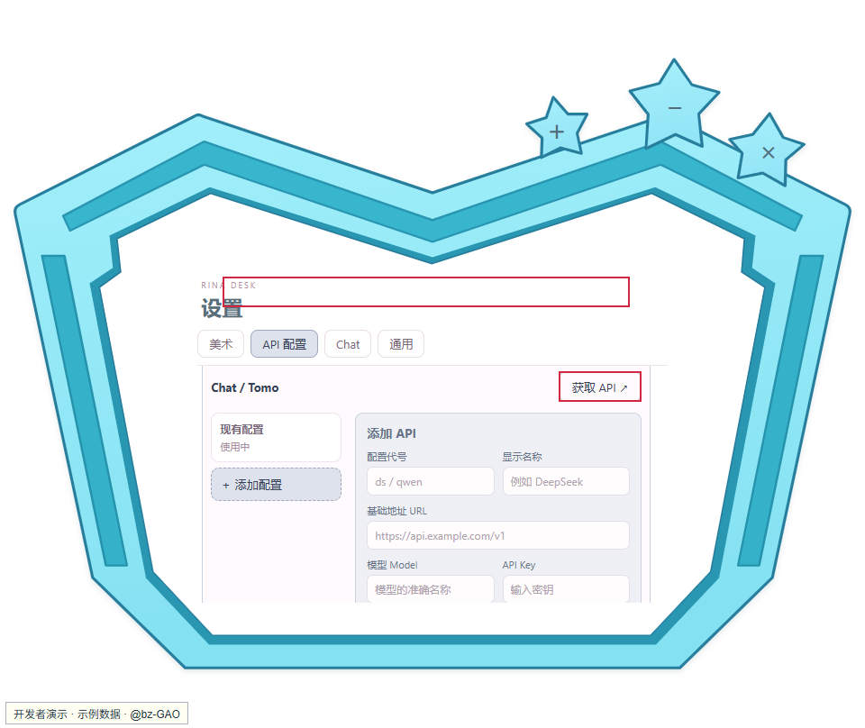
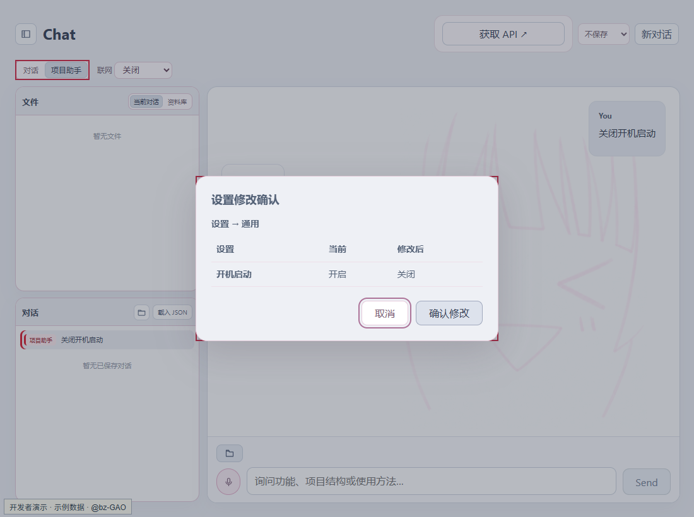
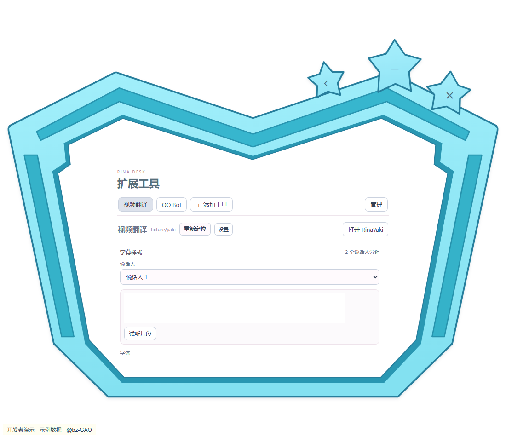
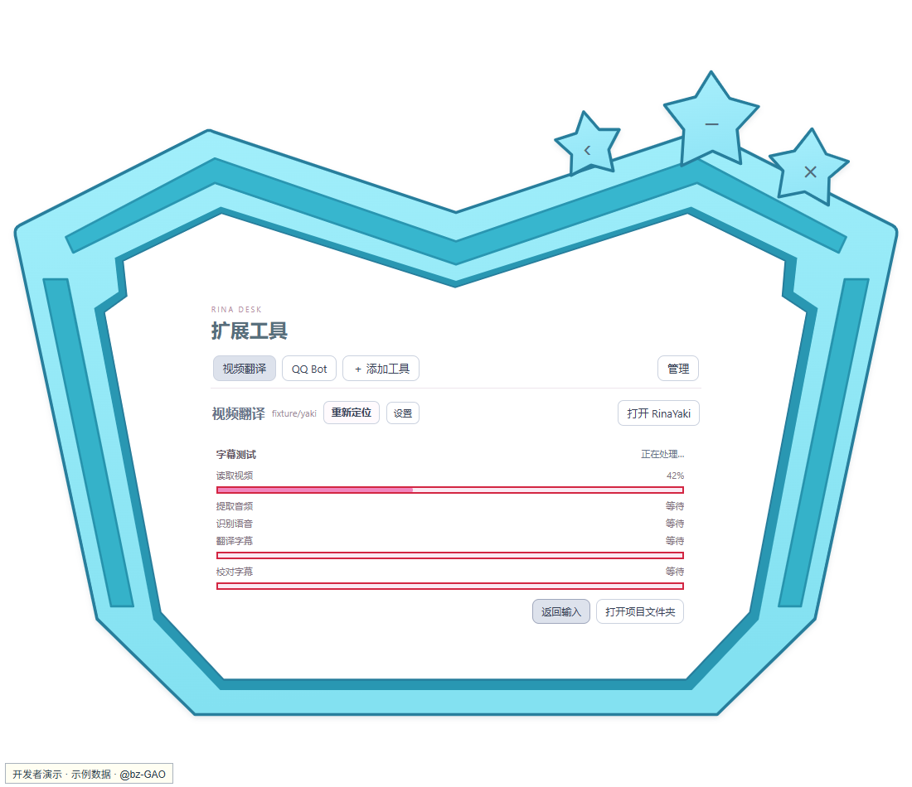
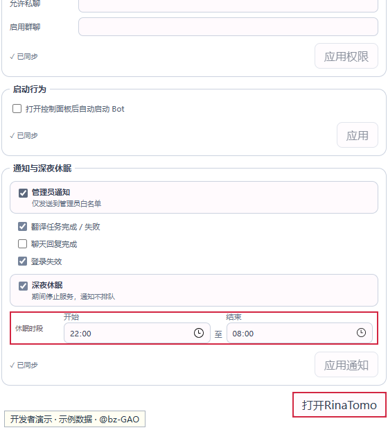
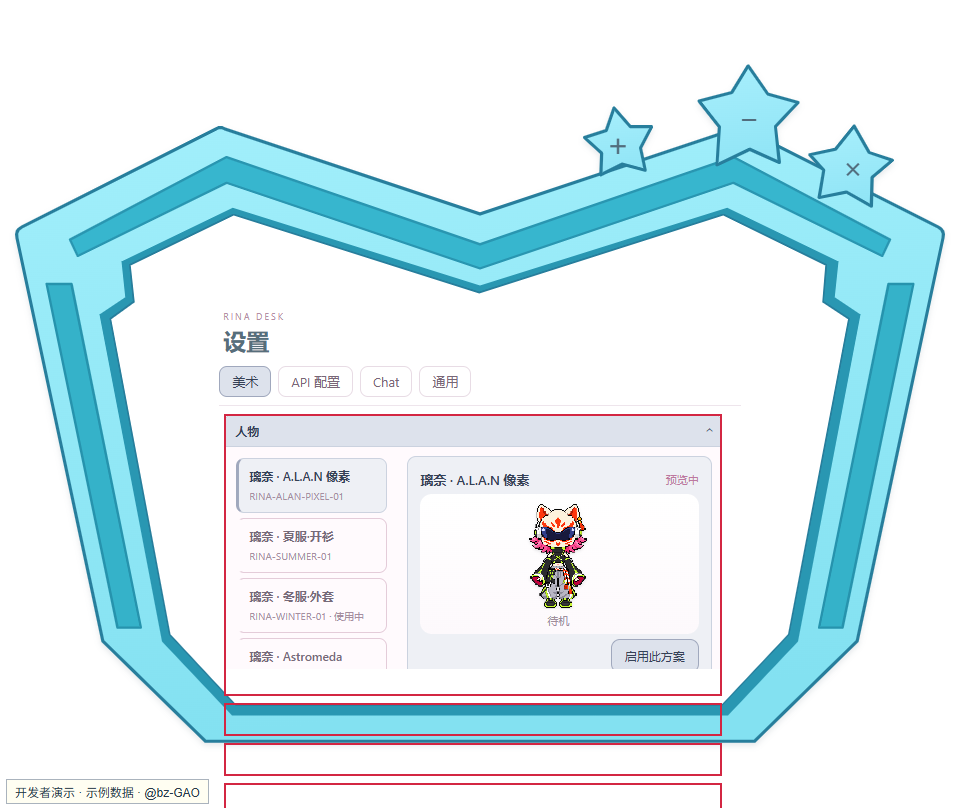

# RinaDesk：面向教与学的个性化桌面 AI 助手

作者：[@bz-GAO](https://github.com/bz-GAO) · [项目主页](https://github.com/bz-GAO/OurDeskPet)  
参赛方向：AI 智能体（Agent）开发 · 更新日期：2026-10-26

## 一、创作背景

学习专业课程时，资料可能来自课堂讲解、外语讲座、公开视频和个人笔记。视频中的术语、讲解节奏及语言差异增加了理解成本；常见 AI 聊天工具又往往停留在单次问答，视频处理、知识梳理和任务通知仍要分开操作。

RinaDesk 以个性化桌宠作为常驻学习入口，将对话、项目助手、视频字幕与 QQ 消息服务放到同一套桌面交互中。项目助手负责理解需求、查询状态、提出操作并展示任务结果；涉及执行的步骤由用户确认。

设计重点是让 AI 参与“获取材料—理解讲解—整理知识—复习反馈”的实际过程。桌宠的说话、拖动和休眠反馈为不同状态提供直观提示，减少把多个工具并排堆放所带来的割裂感。

## 二、功能介绍

### 2.1 三个组件

| 组件 | 作用 | 典型场景 |
| --- | --- | --- |
| RinaDesk | 桌宠、Chat、项目助手、语音、账户与用量展示 | 梳理课程笔记、解释术语、生成自测问题、跟踪任务 |
| RinaYaki | 视频转写翻译、字幕导出、实时字幕 | 提取课程讲解字幕、理解外语讲座、辅助回看复习 |
| RinaTomo | QQ 消息服务、权限管理和事件通知 | 用允许的 QQ 入口提问、接收字幕处理完成提醒 |

### 2.2 项目助手

项目助手把自然语言请求接到实际功能上。它可以查询 Desk 诊断、Yaki 接入状态和 Tomo 运行状态；对于支持的设置，先展示修改内容，确认后再应用。

视频翻译可从 Chat 发起：提供链接、确认预览，再确认项目名和保存位置后启动。任务卡持续显示阶段与进度；处理结束后，可按默认字幕样式导出，或跳转到 Yaki 调整样式。

示例请求：

- “检查一下为什么翻译工具不可用。”
- “关闭开机启动，先让我确认修改。”
- “请把这个视频翻译成中文字幕：〈视频链接〉。”

允许读取项目资料后，助手还可依据项目说明回答使用问题。当前没有任意文件写入或命令执行功能。助手不会自行开通云服务、获取密钥或跳过付费任务确认。

### 2.3 对话、语音与桌宠反馈

Chat 支持多轮对话、上下文压缩、联网搜索、截图及支持格式的附件。对话可自动保存、重命名、重新打开或导出。

语音输入先转成文字，检查后再发送；语音结合回答使用已配置的云服务。当前运行时使用服务商系统音色，角色克隆音色试听属于私有实验，不随提交包分发。

像素人物在说话时显示面罩闪烁，拖动时显示无人机与粒子，休眠时留下独立面具。休眠时位置固定；当前没有自动行走。

### 2.4 教与学场景

| 场景 | 使用方式 | 产出 |
| --- | --- | --- |
| B 站课程或教师讲解视频 | 向助手提供受支持的链接，确认后交给 Yaki 提取与翻译字幕 | 便于回看的字幕视频和字幕文件 |
| 外语专业讲座 | 翻译字幕，将字幕文本复制或作为支持的文本附件交给 Chat | 术语解释、章节提纲、待核对的问题 |
| 课后复习 | 提供自己的笔记或字幕文本，要求按概念、例子和易错点整理 | 复习清单和自测题 |
| 教师备课 | 提供有权使用的讲解材料，要求列出知识点和分层提问 | 讲解提纲和课堂讨论问题草稿 |
| 长任务等待 | 字幕处理中离开工具页，完成后通过桌面或已配置的 QQ 通知查看 | 减少反复切回窗口检查进度 |

例如，处理一段集成电路课程的讲解后，可以将相关字幕提供给 Chat，询问“根据这段讲解整理 MOS 管工作区的判断条件，区分原文结论和补充解释，再出三道自测题”。这是一种基于已提供材料的学习用法，不表示软件已经自动完成字幕到知识库的全程导入，也不保证模型回答正确。

### 2.5 个性化设计

发布版提供一套默认像素人物，统一首次体验，并保留用户导入自有图片的能力。后续计划进一步改善导入与编辑入口，提高人物、热区和反馈的自定义程度。

个性化的目标是让常驻工具贴近使用者的习惯，同时让外观变化承担状态反馈。自动任务、权限确认和结果展示仍是主要功能，不以外观替代实际能力。

## 三、操作指南

### 3.1 安装与首次启动

1. 运行提交目录中的 `OurDeskPet-0.1.0-x64-setup_test.exe`。带 `_test` 后缀的文件是测试包。
2. 选择语言，阅读并勾选接受协议，确认安装位置。
3. 安装完成后启动 RinaDesk。需要模型的功能在配置 API 后使用。

项目入口：[OurDeskPet 仓库](https://github.com/bz-GAO/OurDeskPet)。从 [Releases](https://github.com/bz-GAO/OurDeskPet/releases) 下载安装包及校验值，也可使用随文附带的同版本安装包。

本轮 OurDeskPet 包含 Desk、Yaki、Tomo 三个组件及 Python 运行环境；安装后直接显示视频翻译、实时翻译与 QQ Bot，不需要手动接入目录。QQ 功能还需要准备 QQ 与 NapCat Shell，并使用自己的账号登录；安装包不携带 QQ 账号或登录缓存。

OurDeskPet 使用独立的应用标识、开机启动项、浏览器数据和配置目录，与开发版 RinaDesk 分开。默认用户数据在 `%LOCALAPPDATA%/OurDeskPet/` 下按组件存放；不会自动导入作者的开发设置或音色。

### 3.2 桌宠与璃奈板入口

单击人物打开小璃奈板。三颗星从左到右分别为 Chat、最小化和退出；点击板内笑脸打开设置。拖动清醒的人物移动，右键切换休眠与唤醒。

设置大板的三颗星分别用于扩展工具、最小化设置、关闭设置。关闭设置不会退出整个软件。

### 3.3 获取并配置 API

在“设置 → API 配置”填写服务地址、模型和 API Key，保存并启用。界面中的“获取 API”会打开对应平台。

| 用途 | 官方入口 |
| --- | --- |
| DeepSeek API Key | [创建或管理 Key](https://platform.deepseek.com/api_keys) |
| DeepSeek 用量与余额 | [账户用量](https://platform.deepseek.com/usage) |
| 阿里云百炼 API Key | [获取与配置说明](https://help.aliyun.com/zh/model-studio/get-api-key) |
| 百炼 API Key 页面 | [北京地域控制台](https://bailian.console.aliyun.com/cn-beijing/model/settings/api-key) |
| 阿里云费用与余额 | [账务控制台](https://billing-cost.console.aliyun.com/fortune/billing-account) |

百炼的 Key、服务地址和模型地域应匹配。网页登录不会自动给软件配置 Key。已有 Key 编辑时留空表示保留；不要在截图或反馈中暴露密钥。

### 3.4 账户余额与本机用量

“账户余额”是平台查询结果；“今日花费”是本机记录按参考价格计算的估计值，二者含义不同。优惠、赠金和免费额度可能使本机估计与实际账单不同。

阿里云余额查询需要额外的 RAM 只读授权，它与百炼模型 API Key 分开。无需查询余额时可以跳过，不影响已开通模型的调用。

需要查询时：打开 [RAM 控制台](https://ram.console.aliyun.com/)，按[官方账务 API 授权说明](https://help.aliyun.com/zh/user-center/developer-reference/api-calling-authorization)配置余额查询权限，再在账户卡的“查询阿里云余额”中填写授权信息并连接。界面列出的权限为 `bss:DescribeAcccount`；请按原样核对。刷新失败时可能保留上次查询结果，应留意更新时间。

### 3.5 Chat 与项目助手

1. 打开 Chat，选择“对话”或“项目助手”。
2. 输入需求；需要理解文件时添加附件，需要最新信息时启用联网搜索。
3. 出现设置修改或任务确认卡时，核对内容后确认或取消。
4. 需要保留会话时启用自动保存；侧栏可重新打开、重命名或删除受管理会话。

项目资料读取和设置修改权限在“设置 → Chat → 项目助手”中管理。默认关闭的权限需按实际需要开启。

在“设置 → Chat → 对话保存位置”修改目录，只影响后续保存位置，不自动搬动旧文件。不要删除当前正在打开的会话文件来尝试修复界面。

### 3.6 视频翻译与字幕导出

从项目助手提供视频链接，或进入“扩展工具 → 视频翻译”选择链接、本地视频或已有工程。

1. 预览视频并确认语言、保存位置和工程名。
2. 点击开始并确认。随后自动下载或准备音频、转写、翻译及按配置精修。
3. 查看阶段进度。无法获知总量的阶段显示处理中，不代表卡住。
4. 处理完成后，在任务卡按默认样式导出，或进入 Yaki 选择字体和颜色再导出。
5. 在工程文件夹查看成片。修改样式后复用已有结果导出，不需要重新转写和翻译。

下载受视频站点和账号权限影响；需要登录时使用 Yaki 的登录入口。遇到“上一次付费请求状态不明确”，先检查已有工程，避免反复新建任务。

### 3.7 实时字幕

进入实时翻译，选择系统声音来源、语言、显示方式和可选术语包后开始。暂停期间不接收新声音；恢复后不补录暂停期间的内容。关闭字幕窗口结束会话。仅原文模式仍使用识别服务，但不调用翻译服务。

当前支持以系统声音采集为主；网页直播链接不等于可直接拉流。只有勾选录音才保存音频。

### 3.8 QQ Bot 与通知

首次使用需准备 Tomo、NapCat 和 QQ 环境。在“扩展工具 → QQ Bot”点击“启动 Tomo”，等待二维码后扫码登录。二维码过期点击“刷新”；需要更多操作时点击页面底部“打开RinaTomo”。

设置管理员、允许私聊用户和启用群聊，点击对应区域“应用”。未放行的消息默认不回复。模型回复还需配置 Tomo 自己的 API；Desk 的 Key 不会自动共享。

已放行的消息使用“问：”或“问:”开头触发模型回复。“暂停”停止回复；“关闭服务”结束托管服务。

在“通知与深夜休眠”中设置事件和时段。翻译任务完成／失败已接入通知；聊天回复完成、登录失效的 Desk 事件接线仍待后续完成。深夜休眠期间停止服务，通知丢弃且不补发。

### 3.9 语音和外观

Chat 输入行的麦克风用于录音识别，识别文字进入输入框后再发送。取消录音不发送消息。语音回复需要可用的语音服务配置；私人角色音色不属于标准体验的前置条件。

美术页可查看人物、主题、高级特效和音效。发布版只保留默认像素人物，支持用户导入自己的图片；本说明中的开发界面可能显示额外方案。

## 四、效果演示

本说明的截图由当前程序前端通过开发调用生成，使用示例数据并以红框标注操作点；不会展示真实密钥、账户或可登录二维码。截图用于说明交互，不代表额外执行了一次付费任务。

| 演示 | 操作 | 应观察的结果 |
| --- | --- | --- |
| 桌面入口 | 单击人物，使用三颗星与笑脸 | 进入 Chat／设置，最小化或退出 |
| 助手修改设置 | 询问关闭开机启动 | 显示修改前后，确认后出现执行结果 |
| 视频翻译 | 提供视频并确认任务 | 任务卡推进，结果可导出或转到 Yaki |
| 字幕调整 | 切换说话人、字体和描边色 | 预览更新，可复用处理结果导出 |
| QQ 服务 | 启动 Tomo 并登录 | 显示登录状态，可控制服务与权限 |
| 语音与桌宠 | 录音、播放回复、拖动、休眠 | 文字录入、声音播放及对应视觉反馈 |

已有一次由用户完成的 Chat 助手视频翻译流程。长视频、真实麦克风和 QQ 通知的进一步验收继续进行；具体设备和账号条件会影响体验。

## 五、常见问题

### 5.1 配了 Key 仍不能用

确认已启用该配置，模型名称、服务地址、地域和账户权限正确。Yaki、Tomo 各自保存配置，需要在各自工具页确认。

### 5.2 扩展工具没有出现

OurDeskPet 的组件路径由安装器管理。请确认组件目录未被单独移动或删除，必要时重新运行安装器修复。开发版 RinaDesk 的“添加工具”与此不同，不需要在发布版重复操作。

### 5.3 任务没有精确百分比或导出很慢

云端等待阶段可能只有状态；导出包含本机视频转码，时间受视频长度和电脑性能影响。先检查阶段和工程状态，不要重复启动同一任务。

### 5.4 关闭窗口后任务仍在运行

关闭设置或离开工具页不等于结束后台任务。通过任务或服务的停止入口确认；Tomo 的“关闭服务”用于结束托管链。

## 六、使用与资源许可

项目自有内容未经作者书面许可不得用于商业用途。美术、音频等资源未经相应权利人许可不得擅自提取、转载或再分发，包括个人非商业传播；第三方组件的既有许可仍然有效。

作者署名不代表取得全部角色或素材的分发授权。提交包不应携带私人录音、账号绑定音色、API Key 或登录缓存。安装时请阅读完整许可文本。

## 七、提交文件

- `RinaDesk参赛说明与使用指南.md`：本文。
- `使用说明/图片/`：本文引用的标注截图；提交时保留该目录结构。
- `OurDeskPet-0.1.0-x64-setup_test.exe`：当前统一测试安装包。
- 同名 `.sha256`：安装包校验值。

提交前填写活动要求的队名／姓名，并按活动格式命名最终压缩包。本文不替代报名表中的个人信息。
