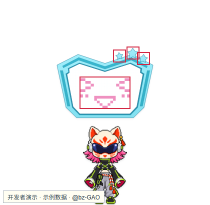

# OurDeskPet 用户手册

作者：[@bz-GAO](https://github.com/bz-GAO) · [项目主页](https://github.com/bz-GAO/OurDeskPet)

适用版本：0.1.0 · 更新日期：2026-10-26

OurDeskPet 是一套以桌宠为常驻入口的桌面 AI 工具，整合 Chat、项目助手、视频字幕、实时字幕、QQ 消息服务与语音交互。

## 一、安装与首次启动

1. 从 [GitHub Releases](https://github.com/bz-GAO/OurDeskPet/releases) 下载 `OurDeskPet-0.1.0-x64-setup.exe`。
2. 选择语言，阅读并勾选接受许可，选择安装父目录（例如 `E:\`）。安装器会在其下自动创建 `OurDeskPet` 文件夹。
3. 安装包同时安装 RinaDesk、RinaYaki 和 RinaTomo，无需手动添加组件目录。
4. 启动 OurDeskPet，再在“设置 → API 配置”填写自己的服务地址、模型和 API Key。

若选择 `E:\`，程序、三个组件和便携运行时位于 `E:\OurDeskPet`。用户数据位于该目录下的 `data/RinaDesk`、`data/RinaYaki`、`data/RinaTomo`。不要单独移动组件文件夹；需要改变安装位置时，重新运行安装包。

## 二、桌宠与主入口

单击人物打开小璃奈板。三颗星从左到右分别为 Chat、最小化和退出；点击板内笑脸打开设置。拖动清醒的人物可以移动，右键切换休眠与唤醒。

## 三、API 与用量

在“设置 → API 配置”中保存并启用配置。已有 Key 编辑时留空表示保留；不要在截图或问题反馈中暴露密钥。

| 用途 | 官方入口 |
| --- | --- |
| DeepSeek API Key | [创建或管理 Key](https://platform.deepseek.com/api_keys) |
| DeepSeek 用量与余额 | [账户用量](https://platform.deepseek.com/usage) |
| 阿里云百炼 API Key | [获取与配置说明](https://help.aliyun.com/zh/model-studio/get-api-key) |
| 百炼 API Key 页面 | [北京地域控制台](https://bailian.console.aliyun.com/cn-beijing/model/settings/api-key) |
| 阿里云费用与余额 | [账务控制台](https://billing-cost.console.aliyun.com/fortune/billing-account) |

“账户余额”是平台查询结果；“今日花费”是本机记录按参考价格计算的估计值。优惠、赠金和免费额度可能使两者不同。阿里云余额查询需要额外的 RAM 只读授权，与百炼模型 API Key 分开；不需要查询时可以跳过。

## 四、Chat 与项目助手

Chat 支持多轮对话、上下文压缩、联网搜索、截图及支持格式的附件。会话可自动保存、重命名、重新打开或导出。

项目助手可以查询 Desk 诊断、Yaki 接入状态和 Tomo 运行状态。需要修改支持的设置或开始付费任务时，先展示内容，经用户确认后执行。

在“设置 → Chat → 项目助手”管理项目资料读取和设置修改权限。默认关闭的权限需按实际需要开启。

## 五、视频字幕与实时字幕

从项目助手提供视频链接，或进入“扩展工具 → 视频翻译”选择链接、本地视频或已有工程。

1. 预览视频并确认语言、保存位置和工程名。
2. 确认后自动下载或准备音频、转写、翻译及按配置精修。
3. 任务卡显示当前阶段。无法获知总量的阶段显示处理中，不代表卡住。
4. 处理完成后可按默认样式导出，或进入 Yaki 调整字体、颜色和说话人后重新导出。

实时字幕从系统声音采集开始。选择语言、显示方式和可选术语包后启动。暂停期间不接收新声音，恢复后不补录暂停内容。仅勾选录音时才保存音频。

## 六、QQ Bot 与通知

QQ Bot 需要用户自行安装 [QQ](https://im.qq.com/pcqq/index.shtml)，并按 [NapCat Windows Shell 官方说明](https://napneko.github.io/guide/boot/Shell) 安装 NapCat。缺少 Tomo 文件时，重新运行完整 OurDeskPet 安装包修复。

在“扩展工具 → QQ Bot”点击“启动 Tomo”，等待二维码后扫码登录。二维码过期点击“刷新”；需要选择 QQ／NapCat 路径时，点击“打开RinaTomo”。

设置管理员、允许私聊用户和群聊权限后点击对应“应用”。未放行的消息默认不回复。模型回复还需要配置 Tomo 自己的 API；Desk 的 Key 不会自动共享。

## 七、语音与外观

Chat 输入行的麦克风用于录音识别，识别文字进入输入框后再发送。取消录音不发送消息。语音回复使用 Qwen Audio 3.1 官方基础音色，需要用户自己的可用服务配置。

发布版提供一套默认像素人物，并支持用户导入自有图片。

## 八、常见问题

### 8.1 配置了 Key 仍不能用

确认已启用该配置，模型名称、服务地址、地域和账户权限正确。Yaki 和 Tomo 各自保存配置，需要在各自工具页确认。

### 8.2 扩展工具没有出现

确认组件目录未被单独移动或删除，必要时重新运行安装包修复。

### 8.3 任务没有精确百分比或导出很慢

云端等待阶段可能只显示状态；导出包含本机视频转码，时间受视频长度和电脑性能影响。先检查阶段和工程状态，不要重复启动同一任务。

### 8.4 关闭窗口后任务仍在运行

关闭设置或离开工具页不等于结束后台任务。通过任务或服务的停止入口确认；Tomo 的“关闭服务”用于结束托管链。

## 九、使用与资源许可

项目自有内容未经作者书面许可不得用于商业用途。美术、音频等资源未经相应权利人许可不得擅自提取、转载或再分发，包括个人非商业传播；第三方组件的既有许可仍然有效。安装时请阅读完整许可文本。
